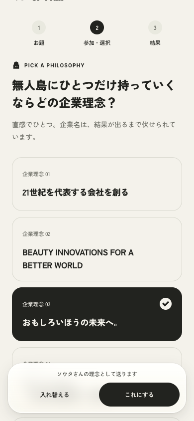
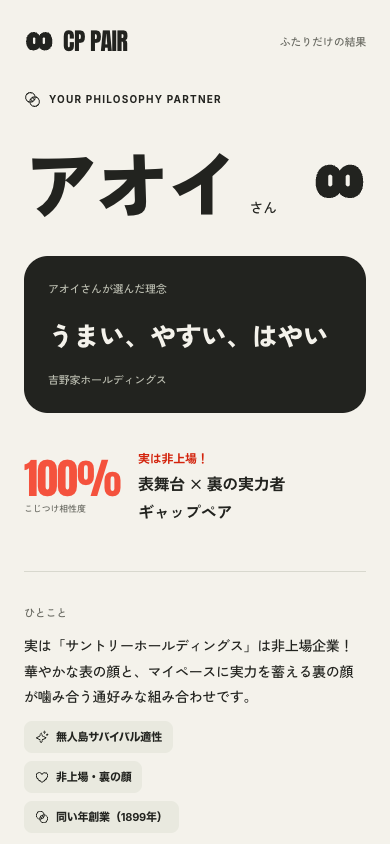

# CP PAIR

合コンで遊ぶ、真顔のパーティーゲーム。各自が好きな企業理念（Corporate Philosophy）をひとつ選び、選んだ理念どうしの「こじつけ相性」で男女のペアを決めて発表する。

**https://cppair.synsk.me/**

<p>
  
  
</p>

## 遊び方

1. **お題を選ぶ** — ホストが「無人島にひとつだけ持っていくならどの企業理念？」のようなお題を選び、ルームを作る
2. **理念を選ぶ** — 参加者は QR コードから参加し、企業名を伏せた 100 社の理念からひとつ選ぶ。スマホを持たない人は、ホストの端末で登録して端末を回して選ぶ
3. **発表する** — ホストが登録完了を宣言すると、創業年・業界・非上場などの共通点をこじつけて相性度と称号を付け、男女のペアを発表する。結果の画面で企業名が明かされる

## 特長

- **iPhone の Safari 向け** — スマホの縦画面を前提にした画面
- **電波がなくても遊べる** — 一度オンラインで開いた端末は、ネットワークなしでも開いて最後まで遊べる。地下の店でも、ホストの端末だけで進められる
- **登録不要** — アカウントもアプリのインストールも要らない

## 開発

### 必要なもの

- Node.js 22.18 以上（`npm run verify` が `node` で TypeScript を直接実行するため）。手元と配信のビルドは Node.js 24 で動かしている
- JDK 21 以上（`npm run test:firestore` が使う Firebase のエミュレーターの要件）

### はじめかた

```sh
npm install
npm run dev
```

- ホストの画面: http://localhost:5173/
- 開発パネル: http://localhost:5173/?dev 。画面の右下の `DEV` から、ホストと参加者の端末の切り替え、テスト用の 4 人の投入、データの消去ができる。1 台のブラウザで、複数の端末での遊び方を再現できる

### コマンド

| コマンド | 内容 |
|---|---|
| `npm run dev` | 開発用のサーバを起動する |
| `npm run build` | 型を検査し、`dist/` にビルドする |
| `npm run lint` | oxlint で検査する |
| `npm run design:lint` | `DESIGN.md` が DESIGN.md の仕様どおりかを、公式の CLI（`@google/design.md`）で検査する。値の形・参照切れ・文字と背景のコントラストを見る。エラーがあると失敗する。警告の 2 件（罫の色が部品から参照されていない）は、仕様に線の色の項目がないため消せない |
| `npm run verify` | 相性の計算が、元のモックと同じ結果を返すかを確かめる |
| `npm run test:e2e` | localStorage 版をビルドして Playwright で動かし、ホストの端末だけで結果まで進む流れと、オフラインでの開き直しを確かめる |
| `npm run test:deploy` | Preview コマンドの `wrangler preview` が、`wrangler.jsonc` の設定の検査を通るかを確かめる。無効なトークンを渡すので、Cloudflare には何も作られない。トークンが拒まれるところまで進むので、ネットワークが要る |
| `npm run test:firestore` | Firestore のエミュレーターを立て、`firestore.rules` が許す操作と拒む操作、Firestore 版の保存の動きを確かめる |
| `npm run test:e2e:firestore` | Auth と Firestore のエミュレーターを立て、Firestore 版のビルドを Playwright で動かし、オフラインモードへの切り替えと解除を確かめる |

`test:e2e` を初めて動かす前に `npx playwright install chromium` でブラウザを入れる。

### デザイン

- 決まり（意図・使い方・Do's and Don'ts）は `DESIGN.md` にある。画面や部品を作る・変えるときは、これに従う
- 描画に使う値の原本は `src/styles/tokens.css`、動きの時間は `src/styles/motion.ts`。`DESIGN.md` の値は文章から指すための写しなので、値を変えたら `DESIGN.md` も合わせ、`npm run design:lint` を通す
- 色は 2 段。`--palette-*` は値そのもので `tokens.css` の外では使わない。部品は用途の名前（`--surface`・`--text` など）だけを使う。1 つの部品でしか使わない値は、その部品のファイルに `--_*` として置く
- 動きの時間は CSS に書かない。`motion.ts` の `CSS_MOTION` に足すと、起動時に `--motion-*` として `:root` に入る
- Framer の元データ（2026-11-27 に書き出した写し）は `docs/design/framer/` にある。Framer は今後の原本ではない

### 見た目を変えない変更の確かめ方

CSS の整理など、見た目を変えないはずの変更は、全画面を撮り直して変更の前の画像と比べる。撮影のスクリプトは乱数の種を固定しているので、同じ画面なら同じ画像になる。

1. `npm run dev -- --port 5199` で開発用のサーバを起動する
2. `npx -y @playwright/cli@latest open http://localhost:5199/` と `npx -y @playwright/cli@latest resize 390 844` でブラウザを開く
3. `npx -y @playwright/cli@latest run-code --filename=scripts/screenshots.js` で `docs/screenshots/` に撮る
4. 変更の前の画像（`git show HEAD:docs/screenshots/<名前>.png`）と比べる。ImageMagick があれば `magick compare -metric AE <前> <後> null:` で、違う画素の数が出る
5. `npx -y @playwright/cli@latest close` でブラウザを閉じる

- `04-handoff-manual`（うなずき）と `09-toast-success`（トーストが出る途中）は、動きの途中を撮るので毎回少し変わる。この 2 枚は目で比べる
- ルール・about・開発パネルの画面はスクリプトに入っていない。触ったときは別に撮って比べる

### 構成

```
src/
  game/      相性の計算（エンジン・お題・こじつけの条件）
  data/      企業理念 100 社のデータ
  store/     ルームの保存。RoomStore のインターフェースと、localStorage の実装と Firestore の実装
  screens/   ホストと参加者の画面、理念選び、結果
  ui/        共通の部品・記号・トースト
  styles/    デザインの値（tokens.css）、部品ごとのスタイル（components/）、画面のスタイル
  dev/       ?dev の開発パネル
e2e/         Playwright のテスト（既定の版）
e2e-firestore/ Playwright のテスト（Firestore 版。エミュレーターにつなぐ）
test/        Firestore のルールと保存の層のテスト（Vitest）
scripts/     計算の照合（verify-matching.ts）とスクリーンショットの撮影
docs/        デザインの値（design/。Framer の元データは design/framer/）と全画面のスクリーンショット（screenshots/）
DESIGN.md    デザインの決まり（意図・使い方・Do's and Don'ts）
```

- 画面の経路は URL のハッシュ（`#/host/...`、`#/r/<ルーム ID>`、`#/rules`、`#/about`）で分ける
- ルームのデータは `src/store/RoomStore.ts` のインターフェースを通して出し入れする。`VITE_ROOM_STORE=firestore` のときは Firestore の実装（`firestoreRoomStore.ts`）を、そうでなければ localStorage の実装を使う。守りは `firestore.rules` にある
- 設定: 本番とプレビューのビルド（`npm run build`）は、リポジトリの `.env.production`（Firestore 版と cp-pair の Firebase の値）を読む。値は秘密ではない。`npm run dev` は `.env.production` を読まず、`.env.local` がなければ localStorage 版で動く。手元の設定の雛形は `.env.local.example`
- Firestore 版では、ホストの端末がつながらないときにオフラインモード（ホストの端末 1 台で進める状態）へ自動で入り、そのルームを localStorage の実装に置く。入るのは、ルームを作るときにネットが無いか Firestore に作れなかったときと、ルームの途中でブラウザの `offline` イベントを受けたとき。解除はホストが画面の「各自の端末での参加に戻す」で行い、ホストの端末のルームを Firestore へ引き継ぐ。切り替えは `src/store/index.ts`、記録は `src/store/offlineMode.ts` にある
- Firestore 版では、参加者の端末は自分の端末が切れている間だけ「ホストの端末で選んでください」と出し、選択も解除もさせない。解除のときに Firestore を上書きするのは、オフラインモードの間にホストの端末で選び直した人の選択だけ
- テストの設定（`playwright.config.ts`・`playwright.firestore.config.ts`）は `VITE_*` を環境変数で渡し、`.env.local`・`.env.production` の値を使わない
- オフライン: `vite-plugin-pwa`（Workbox）の Service Worker が、ビルドした全ファイルを最初の表示のあとに保存する。新しい版は、オンラインで開いたときに取得して入れ替わる

## 配信

Cloudflare Workers の静的アセット（Worker のスクリプトなし）で配信する。設定は `wrangler.jsonc`。ビルドとデプロイは Cloudflare Workers Builds が GitHub への push を受けて行う。ビルド構成はリポジトリではなく Cloudflare のダッシュボード（Workers & Pages → `cppair` → Settings → Build）が持つ。

| 欄 | 値 |
|------|------|
| ビルド コマンド | `npm run build` |
| デプロイ コマンド | `npm run deploy` |
| Preview コマンド | `npm run preview:branch` |
| プロダクション ブランチ | `main` |

**`deploy` と `preview:branch` はビルドしない。** ビルド コマンドが作った `dist/` を前提にする。手元で使うときは `npm run build` を先に実行する。

**3 欄は `npm run` を通す。** コマンドの実体を `package.json` に置き、リポジトリだけを読めば配信の手順が分かるようにするため。

`main` への push は本番に、それ以外のブランチは Preview になり、PR にプレビュー URL がコメントされる（[Workers Builds の設定](https://developers.cloudflare.com/workers/ci-cd/builds/configuration/)）。

### Preview の消し方

Preview は、ブランチを消しても PR をマージしても残る。自動で消えるのは、Worker あたりの数の上限（無料のプランで 100）に達したときに、最後のデプロイが一番古いものから消えるときだけ（[Workers Previews](https://developers.cloudflare.com/workers/previews/)）。

手で消すときは、ブランチ名を `--name` に渡す。

```sh
npx wrangler preview delete --name <ブランチ名>
```

PR を閉じたときに自動で消したくなったら、GitHub Actions で上のコマンドを動かす手がある（[例](https://developers.cloudflare.com/workers/previews/examples/)）。

### 戻し方

本番を前の版に戻すには、`npx wrangler deployments list` で版の id を見て `npx wrangler rollback <版の id>` を実行する（[Rollbacks](https://developers.cloudflare.com/workers/configuration/versions-and-deployments/rollbacks/)）。`main` に次の push があると戻した版が再び出るので、コードも `git revert` する。

### Firebase

Firebase のプロジェクトは `cp-pair`（Spark プラン）。匿名認証を使い、匿名ユーザーの自動削除をオンにしている。これらの設定は Firebase のコンソールが持つ。

Workers Builds は Firestore のルールをデプロイしない。`firestore.rules` を変えたら、次を手で実行する。`.firebaserc` の既定はエミュレーター用の `demo-cp-pair` なので、`--project cp-pair` を付ける（[ルールのデプロイ](https://firebase.google.com/docs/rules/manage-deploy)、[`--project`](https://firebase.google.com/docs/cli#project_aliases)）。

```sh
npx firebase deploy --only firestore:rules --project cp-pair
```

## 背景

要件・決定・デザインの議論は [ksyunnnn/synsk.me#398](https://github.com/ksyunnnn/synsk.me/issues/398) にある。
